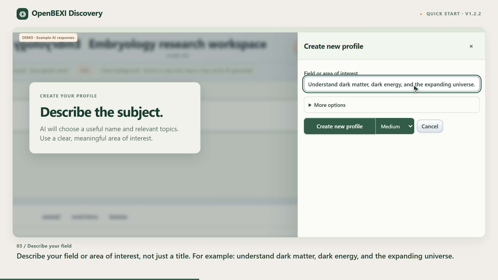

# Create your first OpenBEXI Discovery profile

**[Watch or download the video](openbexi-discovery-create-profile-v1.2.2.mp4)** · 81 seconds · 1920 × 1080 · English narration and on-screen captions

[Subtitles (.srt)](openbexi-discovery-create-profile-v1.2.2.en.srt) · [Transcript](TRANSCRIPT.md) · [User guide](../documentation/USER_GUIDE.md)

The walkthrough focuses on **Settings → Create new profile**: describe a field or area of interest, choose reasoning, create the profile, review its AI-generated overview and topics, and start searching. It also covers connecting AI and switching between saved profiles.

Use the **installed local app** for profiles and AI. The public browser demo has a smaller feature set. Overall and topic web searches currently require OpenAI.

| Time | Step |
| --- | --- |
| 00:00 | Make the workspace yours |
| 00:07 | Connect your AI |
| 00:16 | Create new profile |
| 00:22 | Describe your field |
| 00:31 | Choose reasoning, then create |
| 00:40 | Your profile is ready |
| 00:48 | Review your profile |
| 00:55 | Ask your first question |
| 01:05 | Return to your workspace |
| 01:12 | Create your profile. Then explore. |

Recorded from the v1.2.2 interface at source commit `d9f77ac`. The recording uses the actual application controls and profile storage with an isolated example workspace. AI responses and generation timing are illustrative, as labeled on screen. No real API key, private research, or paid AI request is included. Narration uses a synthetic English voice. Always verify AI output and its sources.
